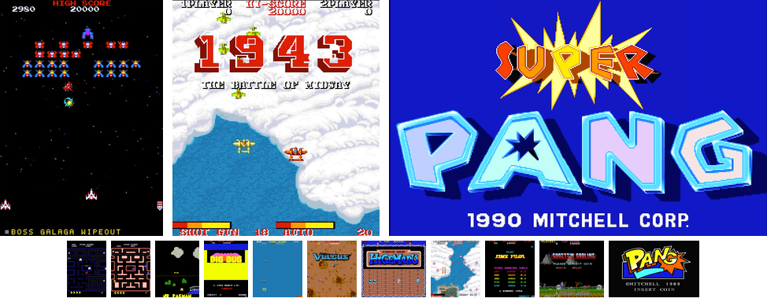
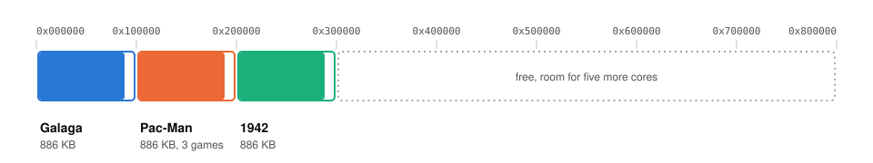
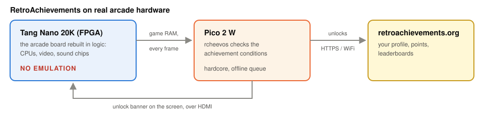

<p align="center"></p>

# game20k: arcade games with RetroAchievements, on real hardware

[](https://github.com/scullymi/game20k/releases/latest)
[](LICENSE)
[](docs/hardware.md)
[](docs/hardware.md)
[](docs/retroachievements.md)

**RetroAchievements on the original arcade circuits, rebuilt in an FPGA. No emulator anywhere.**
A Sipeed Tang Nano 20K recreates the arcade boards in logic, CPUs and sound chips included, and
drives HDMI. A Raspberry Pi Pico 2 W reads the game's RAM every frame, checks the achievements
and shows each unlock as a banner on the screen.



Seventeen games and five regional or speedup sets on eight cores: [docs/games.md](docs/games.md)
lists them with their controls, [docs/images](docs/images/README.md) has screenshots.

> **ROMs are not included and never will be.** You need your own, legally obtained ROM sets.

All eight cores live side by side in the board's 8 MB flash, and the menu switches between them
in seconds:



Every core takes 886 KB of its 1 MB slot, the full configuration size of this FPGA. At power-on
the FPGA loads the core at 0x000000. The games themselves are not in the flash: the ROMs load
from the SD card, and every chip is checked against MAME's checksums when the card is prepared.

## RetroAchievements on real hardware



Achievements count in hardcore by default, with Rich Presence, leaderboards and an achievement
list in the menu. You do not need an account to play. How it works and how to set up an account:
[docs/retroachievements.md](docs/retroachievements.md).

## Quick start

**You need** a Tang Nano 20K, a Raspberry Pi Pico 2 W, a microSD card, a micro USB OTG adapter,
a USB arcade stick, an HDMI monitor and seven wires, see [docs/hardware.md](docs/hardware.md).
Without a Pico, the Nano also runs alone or with a Sipeed M0S Dock (a small BL616 board), then
without RetroAchievements: [docs/bl616.md](docs/bl616.md).

1. **Wire the boards** as shown in [docs/wiring.md](docs/wiring.md). The 5 V supply goes to
   pin 40 (VBUS) of the Pico.
2. **Get the repository and the flash tool.** You need git and Python 3.11.4 or newer. On
   Windows, type `py g20k.py` instead of `python3 g20k.py`.
   ```sh
   git clone --depth 1 https://github.com/scullymi/game20k.git && cd game20k
   python3 g20k.py tools fetch suite
   ```
3. **Prepare the SD card.** Copy your own MAME sets into `roms/`,
   [roms/README.md](roms/README.md) lists the files each game needs. Then run, with the path of
   your card (on Windows, for example, `E:\`):
   ```sh
   python3 g20k.py sdcard /Volumes/YOUR_CARD
   ```
   It checks every chip against MAME before anything goes onto the card. The first run also
   creates `sdcard/config.ini`, without Wi-Fi and RetroAchievements. To use them, fill in that
   file, see [docs/retroachievements.md](docs/retroachievements.md#account), and run the same
   command again, which copies it onto the card.
4. **Flash the Nano.** Connect it by USB. On Windows, it needs the WinUSB driver once, see
   [docs/windows-usb.md](docs/windows-usb.md). Then:
   ```sh
   python3 g20k.py flash --download
   ```
   This downloads the flash image of the latest release, checks it and writes it.
5. **Flash the Pico.**
   ```sh
   python3 g20k.py firmware --download
   ```
   This downloads the firmware of the same release and shows how to copy it onto the Pico, as in
   [docs/wiring.md](docs/wiring.md#firmware-onto-the-pico).
6. **Play.** Insert the card into the Nano and power on. The screen stays dark until LED 5 lights
   up, which means the ROM has loaded. **S2** on the Nano opens the menu.

Building everything yourself, with free tools: [docs/BUILD.md](docs/BUILD.md).

## More

| | |
|---|---|
| [Games, controls and menu](docs/games.md) | [RetroAchievements](docs/retroachievements.md) |
| [Hardware and monitor](docs/hardware.md) | [Wiring](docs/wiring.md) |
| [Building from source](docs/BUILD.md) | [Known issues and plans](docs/status.md) |
| [Screenshots and photos](docs/images/README.md) | [Third-party code and credits](THIRD-PARTY.md) |
| [Without a Pico: the BL616](docs/bl616.md) | [When something does not work](docs/troubleshooting.md) |

## Credits

game20k builds on the cores and code of Dar, MikeJ, Rodimus Prime, Jose Tejada Gomez (jotego),
Ace, MiSTer-X, Daniel Wallner, Guy Hutchison, Greg Miller, Till Harbaum, Sameer Puri,
nand2mario, WangXuan95 and RetroAchievements, and on odelot's
[RetroAchievements fork of the MiSTer main program](https://github.com/odelot/Main_MiSTer), which
showed the way on an FPGA. Who wrote what, with links and licenses:
[THIRD-PARTY.md](THIRD-PARTY.md).

## License, privacy and contact

**GPL-3.0-only** ([LICENSE](LICENSE)), Copyright (C) 2026 scullymi. Third-party parts keep their
own licenses, see [THIRD-PARTY.md](THIRD-PARTY.md).

game20k runs no servers and collects no data. With a RetroAchievements account, the device talks
to retroachievements.org. [PRIVACY.md](PRIVACY.md) lists what it sends and stores, as well as
the local risks of FTP and telnet.

Questions, bugs, build reports and license requests: please open an issue in this repository.
