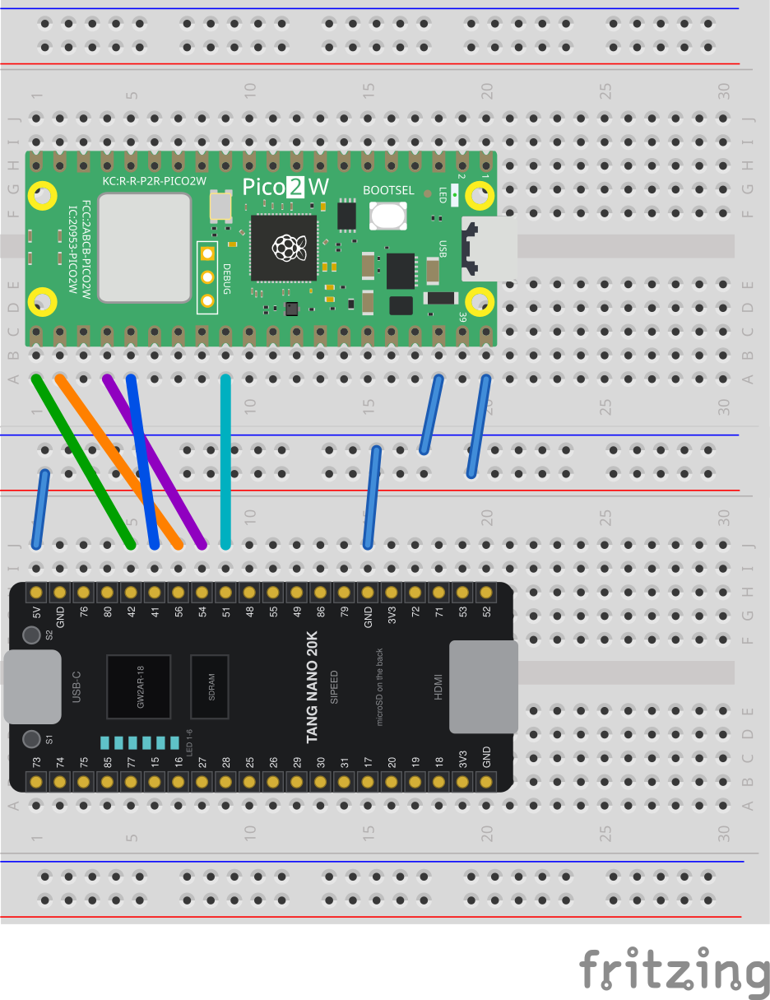

# Wiring: the Companion MCU on the Tang Nano 20K

The Tang Nano 20K has no USB host on the FPGA. The arcade stick is therefore connected to a
Raspberry Pi Pico, which passes the buttons to the FPGA over SPI. There are two ways to connect
the stick to the Pico. The SPI connection is the same for both. Everything runs at 3.3 V, so no
level shifter is needed.

The drawing shows the SPI variant, drawn with Fritzing ([wiring_pico.svg](wiring_pico.svg)).

## SPI connection, same for both variants

Five lines plus ground and supply. The assignment is that of the M0S Dock in the FPGA-Companion
documentation, so the firmware runs unchanged.

| Signal | Print on the Nano | Position, right header | Pico GPIO | Pico pin |
|---|---|---|---|---|
| +5 V | 5V | 1 | VBUS | 40 |
| GND | GND | 2 | GND | 38 |
| MISO | 42 | 5 | GP16 | 21 |
| MOSI | 41 | 6 | GP19 | 25 |
| CSn | 56 | 7 | GP17 | 22 |
| SCK | 54 | 8 | GP18 | 24 |
| IRQn | 51 | 9 | GP22 | 29 |

Positions count from the top, the USB-C side. The right header in full:

**5V, GND, 76, 80, 42, 41, 56, 54, 51, 48, 55, 49, 86, 79, GND, 3V3, 72, 71, 53, 52**

**Two holes stay free between GND and MISO, pins 76 and 80.** Pin 76 goes to the onboard BL616.
The 3V3 of this header is at position 16, not next to the 5 V. The left header, also from the
top:

**73, 74, 75, 85, 77, 15, 16, 27, 28, 25, 26, 29, 30, 31, 17, 20, 19, 18, 3V3, GND**

The pin numbers are printed on the underside only, hidden once the board is plugged in. On early
boards of revision v3920 that print is wrong in several places. There the official schematic
applies.

The supply goes to **VBUS (pin 40)**, not VSYS (pin 39). Only VBUS also feeds the Pico's USB
connector. On VSYS the Pico runs, but a stick on its USB port has no power and never enumerates.

## Variant A: stick on the Pico's own USB port (recommended)

The Pico's micro USB port becomes the host. The stick plugs in through a USB OTG adapter (micro
USB plug to USB A socket).

- No soldering beyond the SPI connection.
- Uses the USB controller in the chip, not the PIO implementation, and is not affected by
  erratum RP2350-E9 (see [hardware.md](hardware.md)).
- Firmware: `python3 g20k.py firmware`.
- To reflash the Pico over USB, unplug the stick. The port is then needed for the computer.
  Also unplug the 5 V line from the Nano, otherwise two 5 V supplies are tied together.

## Variant B: own USB A socket on GP2 and GP3

The Pico generates the USB signal with PIO on two ordinary pins. The stick plugs into a soldered
USB A socket, with no adapter.

| Socket | Pico GPIO | Pico pin |
|---|---|---|
| D+ | GP2 | 4 |
| D- | GP3 | 5 |
| VBUS (5 V) | VBUS | 40 |
| GND | GND | 38 or 23 |

On a USB A socket the contacts are, in order, 5 V, D-, D+, GND. GP2 and GP3 are fixed. The
firmware expects D+ on the lower pin number. Firmware: `python3 g20k.py firmware --usb pio`.

**Pull-down resistors are mandatory:** one from D+ to GND and one from D- to GND, directly at
the socket, 4.7 kOhm on RP2350 stepping A2 and 15 kOhm on A3 and A4. Without them the port works
unreliably or not at all, [hardware.md](hardware.md#rp2350-stepping-and-erratum-e9) explains why.
Even with the resistors, an A2 often misses the stick at power-on until it is replugged.
Variant A does not have this problem. A socket already soldered for variant B can stay while
the native firmware runs, since it does not touch GP2 and GP3.

Recommended for signal quality: 22 Ohm in series at each of GP2 and GP3, D+ and D- twisted,
total length under 10 cm with a ground wire run alongside, 10 uF and 100 nF between VBUS and
GND at the socket. **No** capacitors on D+ or D-.

## Reset button

`RUN` is **pin 30** (eleventh from the top on the right side), with an internal pull-up of about
50 kOhm to 3.3 V. A short to ground resets the chip.

| Button contact | Pin |
|---|---|
| 1 | **30** (RUN) |
| 2 | **28** (GND) |

Both pins are free in this wiring (pins 21, 22, 24, 25, 29, 38 and 40 are in use). Pin 29
between them is IRQn. Do not bridge it when soldering. With the button, *hold BOOTSEL, tap
reset* puts the Pico into the bootloader without unplugging anything.

## Debug port (SWD)

A debug probe on the Pico's three SWD pads flashes the firmware without BOOTSEL and reads its
serial log. Wiring and use: [debugging.md](debugging.md).

## microSD card

The game data is on a microSD card in the slot of the **Tang Nano 20K**, not in the bitstream
and not on the Pico. The Companion reads every sector through the FPGA, where the SD controller
runs. There is nothing to wire, but two header pins are taken by the card: pin 85 (left) is
SD-DAT1, pin 80 (right) is SD-DAT2.

What goes on the card: [sdcard/README.md](../sdcard/README.md). `python3 g20k.py sdcard`
prepares the card and copies that file onto it.

## Bitstream into the FPGA

How to load a core is described in [BUILD.md](BUILD.md#2-cores). Afterwards, **restart the
Pico**: tap its reset button or briefly pull its 5 V
line. Leave the Nano powered, or a bitstream that was only loaded into SRAM is lost.

## Firmware onto the Pico

Unplug the 5 V line from the Nano first, otherwise the computer's 5 V and the Nano's 5 V are
tied together without decoupling. Then hold BOOTSEL, connect the Pico to the computer over USB,
and copy `fpga_companion.uf2` to the drive that appears (`RP2350` on the Pico 2 W).

On the Pico 2 W, macOS ends the copy with an error about extended attributes. That is normal:
the drive disappears as soon as the file is complete, and a vanished drive means success.

## First start check

[troubleshooting.md](troubleshooting.md#first-start) lists what to check after the first
power-on.
